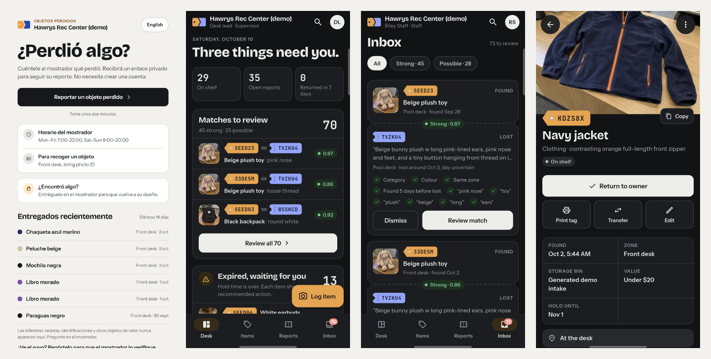
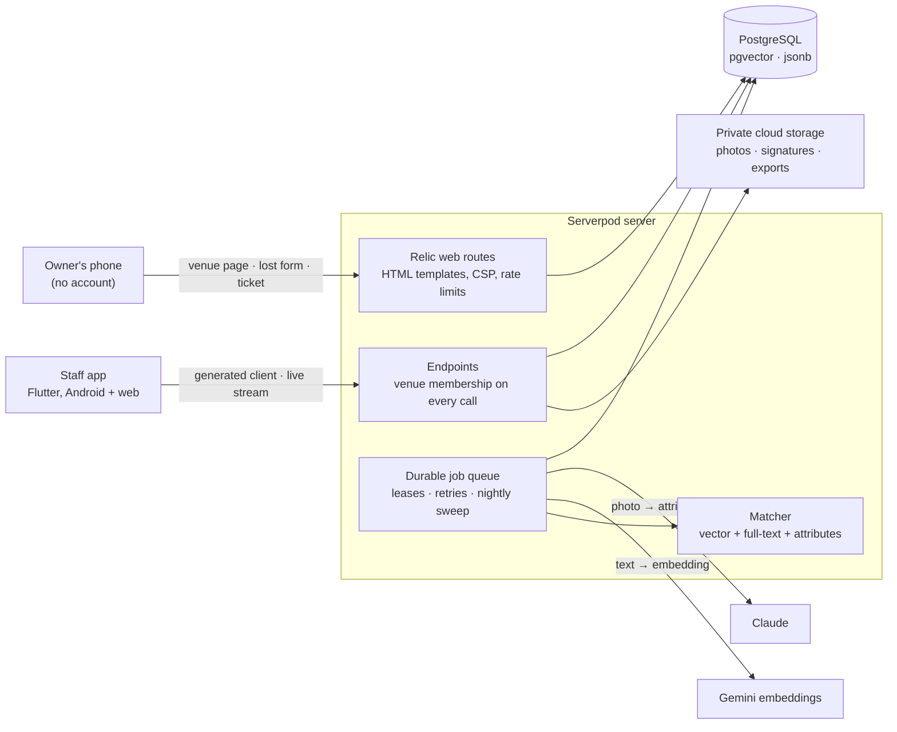

# ClaimDesk

**Lost and found, matched.** ClaimDesk gives a venue's front desk a phone app for what gets handed in, and gives the public a page they can open from a poster to say what they lost. The server matches the two, shows staff *why* a found item might be someone's, and checks ownership before anything is handed back.

One Serverpod 4 backend runs the staff app's API, the public web pages, a durable job queue, and the matching. It deploys to Serverpod Cloud with one command.



## Try it

Start it first with [Run it locally](#run-it-locally). The seed creates a demo venue, a staff account and a supervisor account.

**As someone who lost something.** Open the venue page at http://localhost:8082/v/hawrys-demo (add `?lang=es` for Spanish), tap *Report a lost item*, describe it in your own words and give an email address. You get a private claim ticket that shows what happens next: received, searching, possible match, ready for pickup, returned. No account, no app, no script on the page. The printable poster is at `/v/hawrys-demo/poster`.

**As desk staff.** Sign in to the staff app with the seeded staff or supervisor account.

1. **Desk** shows what needs attention today: new matches, items whose hold time is over, police hand-offs that are due.
2. **Inbox** lists proposed matches as a found-item tag joined to a lost-report ticket, with the score and the evidence (category, colour, place, time, the words both sides used). Open one and *Confirm*.
3. The owner's ticket now asks two questions only the owner could answer. At pickup, **Return to owner** walks through four checks (described it before seeing it, enough details matched, ID seen, who is collecting), takes an optional signature, and records the hand-back.
4. **Items** has search (try `brolly` or a reference such as `SEED01`), filters, photos, a printable shelf tag and the item's full history. Supervisors also get **Export CSV** and **Print poster**.

The demo venue and its people are fictional, and the seeded items use synthetic photos.

## How it works



**One lost report, end to end.** The form posts to a Relic route that validates it, checks for a duplicate, stores it in one serializable transaction and enqueues a `match_report` job. The worker claims the job, runs a quick *preliminary* pass from the form's own hints while Claude normalises the description, then a refined pass. Each pass pulls the nearest items by embedding (pgvector) and by keyword coverage (full-text search), scores them in Dart, and writes the top proposals with their explanation. Open staff apps refresh through a streaming endpoint; the owner's ticket shows "searching", and "possible match" once staff confirm one.

## Built on Serverpod

| Serverpod feature | Where | What it does for ClaimDesk |
| --- | --- | --- |
| pgvector `Vector(1536)` columns and `distanceCosine` ordering | `claimdesk_server/lib/src/models/found_item.spy.yaml`, `lost_report.spy.yaml`, `lib/src/matching/candidate_query.dart` | Nearest found items for a report (and reports for an item), filtered by venue, status and time window |
| Raw SQL through `unsafeQuery`, all values bound | `lib/src/matching/lexical_search.dart`, `lib/src/endpoints/desk_endpoint.dart`, `lib/src/services/venue_exports.dart` | Keyword coverage with PostgreSQL full-text search for matching and staff search; the Desk summary in one `count(*) FILTER` query |
| jsonb columns | `found_item.spy.yaml` (`attributes`), `item_match.spy.yaml` (`explanation`), `work_item.spy.yaml` (`payload`) | Structured caption attributes, the reasons behind each score, and job payloads |
| Transactions and row locks | `lib/src/db/transactions.dart` and callers in `release_endpoint.dart`, `match_endpoint.dart`, `item_endpoint.dart`, `services/public_intake_service.dart` | Serializable transactions with retry for release, confirm, transfer and intake: one hand-back marks the item claimed, the report returned and competing proposals superseded, or nothing at all |
| Durable job queue on the ORM | `lib/src/models/work_item.spy.yaml`, `lib/src/jobs/` | Captioning, embedding, matching and the nightly sweep. Jobs are claimed with `FOR UPDATE SKIP LOCKED`, leased for two minutes with a heartbeat, fenced against stale workers, retried with backoff, and woken right after the enqueue commits. Future calls are not available on the Starter plan, so the queue lives in PostgreSQL |
| Streaming endpoint and messages | `lib/src/endpoints/desk_stream_endpoint.dart`, `session.messages.postMessage` across endpoints and jobs | Every open staff app updates when an item is captioned, a match arrives or an item changes hands |
| Relic web server | `lib/server.dart`, `lib/src/web/public/`, `web/templates/public/` | The venue page, lost form, claim ticket, poster and shelf tag are server-rendered `TemplateWidget`s composed with `ListWidget`; the ticket status is a `JsonWidget`; rate-limit middleware on `/v`, `/t`, `/tag`; cache-busted static assets; `FlutterRoute` serves the staff app at `/app` |
| Logging-disabled sessions | `lib/src/web/public/public_page.dart` | Public routes open sessions with logging off, so ticket tokens and form values never reach the logs |
| Authentication | `lib/src/authentication.dart`, `lib/src/auth/`, `lib/src/access/venue_guard.dart` | Email sign-in, JWT sessions, and Google sign-in that links a Google account to an existing staff member and never creates new users; a guard checks venue membership (and supervisor role where needed) on every venue endpoint |
| Private cloud storage | `lib/server.dart`, `lib/src/endpoints/item_endpoint.dart`, `lib/src/services/photo_upload_relay.dart` | Photos, signatures and CSV exports stay private; staff see them through 10-minute links; browser uploads go through an authenticated relay |
| Typed exceptions and the generated client | `lib/src/models/*_exception.spy.yaml`, `claimdesk_flutter/lib/data/errors.dart` | Refusals such as "already released" or "not a member" reach the app as readable messages |
| `withServerpod` tests | `claimdesk_server/test/integration/` | About 300 server tests against a real embedded PostgreSQL, no Docker |
| Serverpod Cloud | `claimdesk_server/scloud.yaml`, `.scloudignore` | One `scloud deploy` regenerates code, builds the Flutter web app and ships both; secrets are Cloud-managed passwords |

## Matching

Each candidate gets a weighted score over the signals that are actually present (`claimdesk_server/lib/src/matching/scorer.dart`):

| Signal | Weight | How it's measured |
| --- | --- | --- |
| Meaning | 0.40 | Cosine similarity of the two embeddings, rescaled from the 0.76–0.97 range observed between unrelated and true pairs |
| Words in common | 0.15 | Share of the report's key words found in the item's description (PostgreSQL full-text search) |
| Category | 0.15 | Same kind of thing, or the same group |
| Colour | 0.10 | Reported colours present on the item; near colours (navy and blue) count half |
| Brand | 0.08 | Brand or model mentioned on both sides |
| Place | 0.06 | Same zone, or a neighbouring one |
| Time | 0.06 | Found within a couple of days of the loss, fading over six weeks |

A missing signal is left out rather than counted as a miss, and a candidate with neither the category nor the brand in common is capped at 0.40. Scores of 0.70 and above are **strong**, 0.45 and above **possible**. Staff see every signal on the card, so a match is never a black box.

**Evaluation.** A reviewed set of 70 found items (40 described in text, 30 captioned from photos) and 45 lost reports, with the real caption and embedding models, gave **recall@3 1.00**, **MRR 1.00**, **no false strong matches**, and strong-match precision 0.92. The same suite runs in CI with deterministic stand-ins for the models, and checks that the production SQL picks exactly the candidates an independent Dart implementation picks (`claimdesk_server/test/integration/matching_eval_test.dart`).

**Speed on Serverpod Cloud** (Starter plan, measured early October 2026): a photographed item is captioned and searchable in about 13 seconds (median); a new report gets a preliminary match in about 4–7 seconds and the refined one in about 8–16 seconds, depending on database latency on the shared plan.

## Privacy

- **Owners need no account.** A ticket is a private 128-bit link. Public pages are `noindex`, set no cookie and run no script (`script-src 'none'`); ticket pages are also `no-store`, and none of them ever show the owner's name, email, description or proof.
- **The public never sees what's on the shelf in detail.** The venue page lists only recent items by colour, kind, zone and day, and never wallets, cards, IDs, money, medication, jewellery, anything worth $100 or more, or anything that may carry personal data.
- **Restricted items stay vague everywhere.** For those categories the caption keeps only the category, and the photo is purged 30 days after the item leaves the desk.
- **Data has an end date.** Unmatched reports close after 60 days; contact details and answers are deleted 30 days after a report closes or the item is returned.
- **Abuse controls without tracking.** Per-address rate limits use a salted hash of the address; the form has a bot trap and duplicate detection.
- **Photos are cleaned.** Location and camera data is stripped and images are resized before storage; staff notes and finder names are never sent to the AI models.
- **Staff see only their venue.** Every venue call checks membership; exports and posters are for supervisors.

## Why it matters

Small desks still run on a shelf and a spreadsheet, and descriptions rarely line up: the owner says "black brolly with a wooden handle", the log says "umbrella". The demo desk is modelled on a university recreation center's published policy: found items logged in a front-desk spreadsheet, held for 60 days, and anything worth $20 or more handed to police, as [New York Personal Property Law §252](https://www.nysenate.gov/legislation/laws/PEP/252) requires within ten days. ClaimDesk tracks that hand-off date for every valuable item. At a much larger scale, a 2025 review by the MTA Inspector General found that most items auditors handed to subway staff were [never logged at all](https://www.aol.com/mta-poor-track-record-returning-013258496.html).

There has been no live trial at a real desk; the venue and its data are staged. The natural next step is a one-week trial next to a desk's existing spreadsheet, with CSV export back and data deleted on request.

## Run it locally

You need Flutter 3.47.5 (Dart 3.13.4), the Serverpod CLI 4.0.2, Chrome, and for the phone app an Android SDK. Run commands in a normal (non-administrator) terminal.

```powershell
dart install serverpod_cli@4.0.2
flutter pub get
cd claimdesk_server
serverpod run seed     # demo venue, zones, a staff and a supervisor account
serverpod start        # embedded PostgreSQL, API on 8080, web on 8082, staff app in Chrome
```

`serverpod start` manages its own PostgreSQL; Docker and Redis are not needed. Local secrets go in the ignored `claimdesk_server/config/passwords.yaml` (`ipHashSalt` of at least 32 characters, `demoStaffPassword`, `seedSecret`); development has safe fallbacks for the demo password.

**AI providers.** Set `ANTHROPIC_API_KEY` and `GEMINI_API_KEY` in the environment before `serverpod start` to caption photos with `claude-opus-5-5` and embed with `gemini-embedding-2` (1536 dimensions). Without keys the server picks deterministic stand-ins, so everything still runs. On Cloud the keys are the managed passwords `anthropicApiKey` and `geminiApiKey`.

**Google sign-in (optional).** Put the Google Web client's JSON in the `googleClientSecret` password and a staff address in `googleStaffEmail`, then re-run the seed. Without them, Google sign-in stays off.

**Android phone.** With USB debugging on and the server running:

```powershell
cd claimdesk_flutter
adb reverse tcp:8080 tcp:8080
flutter run -d <device-id> --dart-define=SERVER_URL=http://127.0.0.1:8080/
```

Add `--dart-define=GOOGLE_SERVER_CLIENT_ID=<web client id>` to show Google sign-in on Android.

**Public pages** are at http://localhost:8082/v/hawrys-demo once the seed has run; add `?lang=es` for Spanish.

If Windows reports a PostgreSQL executable-path mismatch, set `SERVERPOD_PG_CACHE_DIR` to a folder outside AppData and restart the terminal.

## Tests

```powershell
cd claimdesk_server
dart test                  # about 300 tests, real embedded PostgreSQL, no keys needed
cd ../claimdesk_flutter
flutter test               # widget tests, including tap-target, contrast and 200% text checks
```

Four GitHub workflows run analysis, formatting, the server tests and the app tests on every push. Optional suites: `RUN_PUBLIC_HTTP=true dart test --tags http test/http` against a running local server, and `CLAIMDESK_LIVE_PROVIDERS=1 dart test -t providers` with real model keys.

## Deploy

From `claimdesk_server`, `scloud deploy` regenerates the protocol, builds the Flutter web app into `web/app` and ships both. Set secrets with `scloud password set <name> <value>`; they apply on the next deploy. Seed a fresh Cloud project once through the `admin.seedDemo` endpoint, which needs the `seedSecret` password.

## Repository

- `claimdesk_server` — endpoints, models and migrations, matching, jobs, public web pages, tests
- `claimdesk_client` — generated client (do not edit; change models and endpoints instead)
- `claimdesk_flutter` — the staff app for Android and web
- `docs/screenshots` — images used in this README

## Known limitations

- Owners are not emailed; they keep their ticket link and check it.
- The staff app is in English; the public pages are in English and Spanish. Venue text (hours, zones) is shown as the venue typed it.
- Vector search is an exact scan, which is right for one venue's few thousand items; a larger deployment would add an approximate index.
- Matching latency on the shared Starter plan varies with database load.
- CSV exports stay in private storage after their ten-minute links expire.
